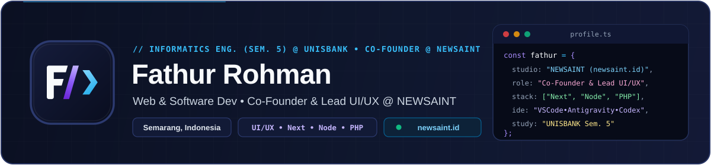

  

   
   

  
  
  
  
  
  

---

### About Me

Hi! I'm **Fathur Rohman**, a **5th-semester Informatics Engineering (S1 Teknik Informatika)** student at **Universitas Stikubank (UNISBANK) Semarang** with a vocational background in **Software Engineering (RPL)**, and **Co-Founder & Lead UI/UX Designer** at **[NewSaint Digital Solutions (NEWSAINT)](https://newsaint.id)**.

- **Co-Founder & Lead UI/UX Designer / Product Strategist @ [NEWSAINT](https://newsaint.id)** *(PT Selaras Digital Labs, Semarang)*: Building digital products in a 3-person core team — leading **UI/UX Design, Design Systems, User Research, Figma**, and **Product Strategy** for websites, SaaS platforms, e-commerce, and company profiles.
- **Web & Software Development:** Building responsive web apps and RESTful APIs using **HTML, CSS, JavaScript, TypeScript, Next.js, React, Node.js, Express, NestJS, PHP & Laravel**.
- **Databases:** Experience working with relational and NoSQL databases (**MySQL, PostgreSQL & MongoDB**).
- **Graphic Design & Publications:** Creating event posters, banners (MMT), Instagram puzzle feeds, certificates & ID cards with **Canva**.
- **Internship Experience:** Completed **2 internship periods (6 months total)** at **Dinas DP3AKB Provinsi Jawa Tengah**, assisting with SIGA Jateng data recapitulation in **Microsoft Excel** and institutional administration.
- **Portfolio & Studio:** Explore personal work at **[fathur-rohman-portfolio.vercel.app](https://fathur-rohman-portfolio.vercel.app)** and studio solutions at **[newsaint.id](https://newsaint.id)**.

---

### Venture & Co-Founded Business

> **[NewSaint Digital Solutions (NEWSAINT)](https://newsaint.id)** — *PT Selaras Digital Labs (Semarang, Indonesia)*  
> Co-founded with 2 engineering partners as a lean 3-person **Digital Product & Technology Studio** delivering custom web applications, SaaS systems, e-commerce platforms, AI bot automation, and modern UI/UX design.  
> **My Role:** `Co-Founder` • `Lead UI/UX Designer` • `Product Strategist` *(Design Systems, User Research, Figma, Product Strategy)*

---

### Tech Stack, IDEs & Coding Workflow

  

 

  
  
  
  
  
  
  
  
  

---

### Featured Projects & Studio Work

| Project / Studio | Stack / Focus | Description | Links |
| :--- | :--- | :--- | :--- |
| **NewSaint Digital Solutions** | `Co-Founder` `Lead UI/UX` `Figma` `Next.js` | Digital product & technology studio co-founded with 2 partners in Semarang | [Website](https://newsaint.id) |
| **API Toko Gitar** | `Node.js` `Express` `MongoDB` `Midtrans` | E-commerce guitar catalog REST API with auth & Midtrans payment webhook | [Repo](https://github.com/fthrrhmn19/api-toko-gitar) • [Live API](https://api-toko-gitar.vercel.app) |
| **API Perpustakaan Kampus** | `NestJS` `TypeScript` `PostgreSQL` `Swagger` | Modular library catalog, member & loan API with OpenAPI 3.0 & Vitest | [Repo](https://github.com/fthrrhmn19/api-perpustakaan-kampus) |
| **AI Study Buddy** | `Laravel` `PHP` `MongoDB` `Groq AI` | AI learning assistant for study summaries, auto-quizzes & document Q&A | [Repo](https://github.com/fthrrhmn19/AI-Study-Buddy) |
| **Sistem Kasir Web (POS)** | `PHP` `MySQL` `Bootstrap 5` | Multi-role web POS for Administrator & Cashier stock/sales management | [Repo](https://github.com/fthrrhmn19/P4Fathur_Kasir) |
| **Personal Portfolio & CV** | `HTML5` `CSS3` `JavaScript` `Vercel` | Interactive portfolio showcasing web apps, NEWSAINT, SIGA work & 30 designs | [Live Site](https://fathur-rohman-portfolio.vercel.app) |

---

### Campus Organizations (2024 – 2027)

- **Dewan Perwakilan Mahasiswa (DPM) UNISBANK** — *Departemen Infokom (2026–2027)*
- **Paguyuban Bidikmisi UNISBANK (PADIKSI)** — *Koordinator Infokom (2026–2027) • Anggota (2024–2026)*
- **Himpunan Mahasiswa Teknik Informatika (HMPS-TI)** — *Staff Desain (2024–2027)*
- **UKM Multimedia / UNISBANK Media Center (UMC)** — *Departemen Produksi (2024–2027)*
- **UKM Bulu Tangkis UNISBANK** — *Koordinator PDD (2026–2027) • Divisi PERKAP (2024–2026)*

---

### Education & Internship

- **S1 Teknik Informatika** — *Universitas Stikubank (UNISBANK) Semarang* (2024 – Present, Semester 5)
- **Rekayasa Perangkat Lunak (RPL)** — *SMK Palapa Semarang* (2021 – 2024)
- **Praktik Kerja Lapangan (2 Periods)** — *Dinas DP3AKB Provinsi Jawa Tengah* (2022 – 2023)
